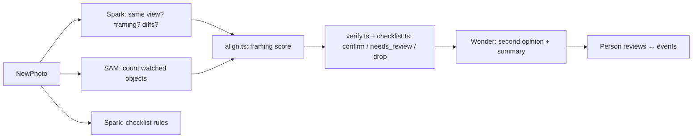

# 🖼️ GoldenFrame

> Give any photo or camera a standard. Get events.

**GoldenFrame checks whether a place looks the way it should.**
Photograph a scene once when it's perfect — the **golden photo** — and every new photo or walkthrough video is compared against it. Differences become findings, a person reviews each inspection, confirmed findings become events.

Built for **hotel rooms, restaurants, and business spaces**. Powered by Meta models: **SAM 3.1** (find + count), **Muse Spark** (compare + checklist), **Muse Wonder** (second opinion + summaries).

   

---

## How it looks

> Add 3 screenshots to `docs/screenshots/` — they sell the whole thing.

| Board | Scene | Inspection |
|---|---|---|
|  |  |  |
| Kanban by next step | Golden photo + checklist + inspections | Golden vs. new, framing, review |

## How it works in 60 seconds

1. **Add a scene** — e.g. `Room 1201 – bed`, group `Floor 12`, assignee `Maria`
2. **Upload the golden photo** — Spark lists objects, SAM outlines + counts them. Click anything else to add it. Write rules or `✦ Draft with Muse Wonder`
3. **Inspect** — `+ New inspection` (photo) or upload a walkthrough video. Get `All good / Issues / Needs review / Retake` + Wonder summary
4. **Review** — confirm or dismiss each flag, add a note, mark Reviewed. Done.

## ✨ Features

**Scenes board**
- Kanban: `Not set up → Ready → Needs review → Issues → Reviewed` with live counts
- Groups (location / floor / client) + assignees with autocomplete, sidebar filters
- Inspection counts on every card: `5 inspections · 1 to review`

**Scene page**
- Golden photo with upload progress bar, auto-detect, tap-to-add, hover spotlight
- Checklist in collapsible sections (`THE BED: Duvet is smooth…`)
- Inspections list with photo / video source, review pills, one-click delete

**Checks you can trust**
- Spark compares + checks rules, SAM counts — in parallel
- Framing score 0–100: `aligned / slightly_off / far_off` with retake hints (`Turn a little right`)
- Rules decide, not vibes: SAM counts are truth for objects, Spark-only calls go to a person
- Wonder second-opinion before anything reaches you + auto-dismisses clear-fine

**Review & history**
- `Needs review / Reviewed` per inspection, blocked until all flags decided
- Notes, who/when, full history. No accounts — name remembered in browser

**Walkthroughs**
- One video → 1 frame/sec → best frame per scene → inspection per scene. Missing scenes marked `Not seen`

**Ops built-in**
- Live SSE progress, Model activity page with per-call time + cost + daily cap
- Optional `ACCESS_CODE`, single-server deploy (`npm run build + npm start`), Fly.io ready

## 🚀 Quickstart

Requirements: Node 22.5+, `ffmpeg` on PATH (`brew install ffmpeg`), Meta API key.

```bash
git clone https://github.com/nodarik/GoldenFrameAI.git
cd GoldenFrameAI
npm install
echo "MODEL_API_KEY=your-meta-api-key" > .env
npm run dev
```

Open http://localhost:5173 (API on :8791, proxied).

## ⚙️ Configuration

| Variable | Default | What |
|---|---|---|
| `MODEL_API_KEY` | required | Meta model API key |
| `SPARK_MODEL` / `WONDER_MODEL` / `SAM_MODEL` | `muse-spark-1.3` / `muse-wonder-1.0` / `sam-3.1` | Model pins |
| `ACCESS_CODE` | empty | Gate public deploys. Empty = no login (local only) |
| `DATA_DIR` | `./data` | SQLite + photos + videos + frames (git-ignored, EXIF stripped) |
| `DAILY_SPEND_LIMIT_USD` | `10` | Hard stop for model calls |
| `API_PORT` / `FFMPEG_PATH` | `8791` / `ffmpeg` | Ports / binary |

<details>
<summary>All scripts</summary>

| Command | What |
|---|---|
| `npm run dev` | API (watch) + web (HMR) |
| `npm run build` / `npm start` | Build web to `dist/web` / serve it from API (`http://localhost:8791`) |
| `npm run typecheck` / `npm run spike` | `tsc --noEmit` / model experiments |

</details>

## 🧠 Pipeline



> `server/verify.ts`, `checklist.ts`, `align.ts` turn model output into decisions with a reason each. Models never auto-confirm issues.

## 🔌 API & webhooks

Per-scene token: Scene → **API & webhook**. Send a photo, get a check, receive `check.finished`:

```bash
curl -H "Authorization: Bearer $TOKEN" -F image=@photo.jpg \
  https://your-app.example/api/ingest/$SCENE_ID
# 202 {"checkId":"chk_…","snapshotId":"snp_…"}
```

Verify: HMAC-SHA256 body with webhook secret == `X-GoldenFrame-Signature`.

<details>
<summary>Payload + fetch example</summary>

```json
{ "event": "check.finished", "check": { "id": "chk_…", "sceneId": "scn_…", "status": "issues", "score": { "ok": 4, "total": 5 } } }
```

```bash
curl -H "Authorization: Bearer $TOKEN" \
  https://your-app.example/api/ingest/$SCENE_ID/checks/$CHECK_ID
```

</details>

## 📁 Project layout

```
server/ index.ts db.ts meta.ts golden.ts verify.ts align.ts checklist.ts setup.ts images.ts runlog.ts video/
web/ main.tsx board.tsx scene.tsx inspection.tsx photo.tsx video.tsx api.ts styles.css
scripts/spike.ts  fly.toml  vite.config.ts
```

## Privacy

Local-first: everything in `DATA_DIR`. Re-encoded uploads strip GPS. `data/` + `.env` ignored.

## License

MIT
