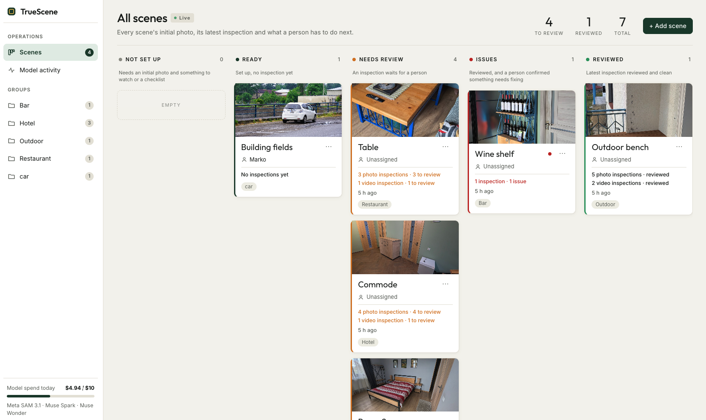
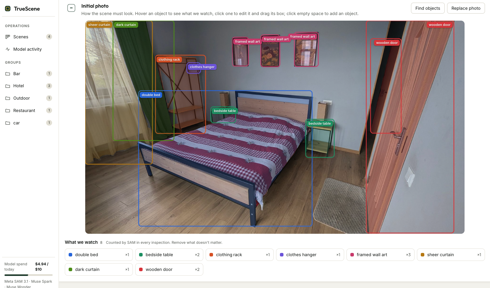
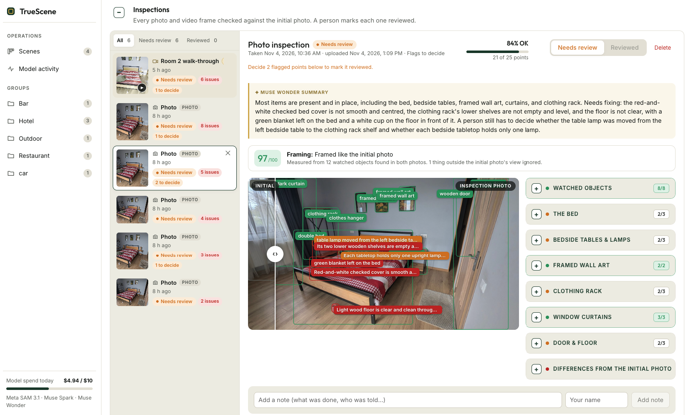
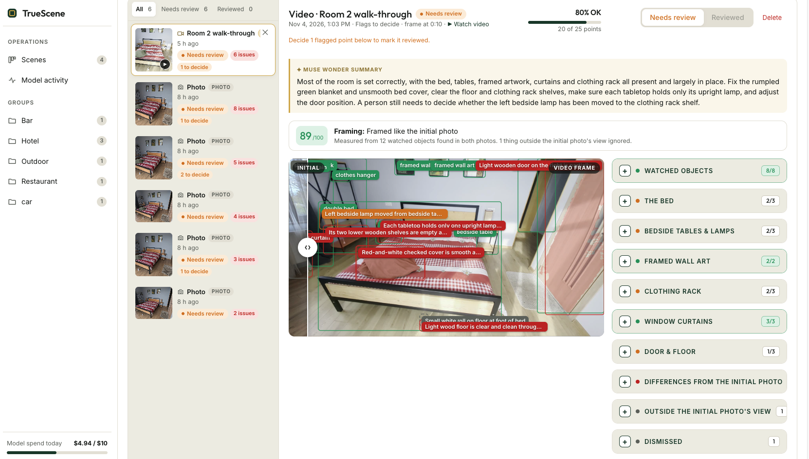
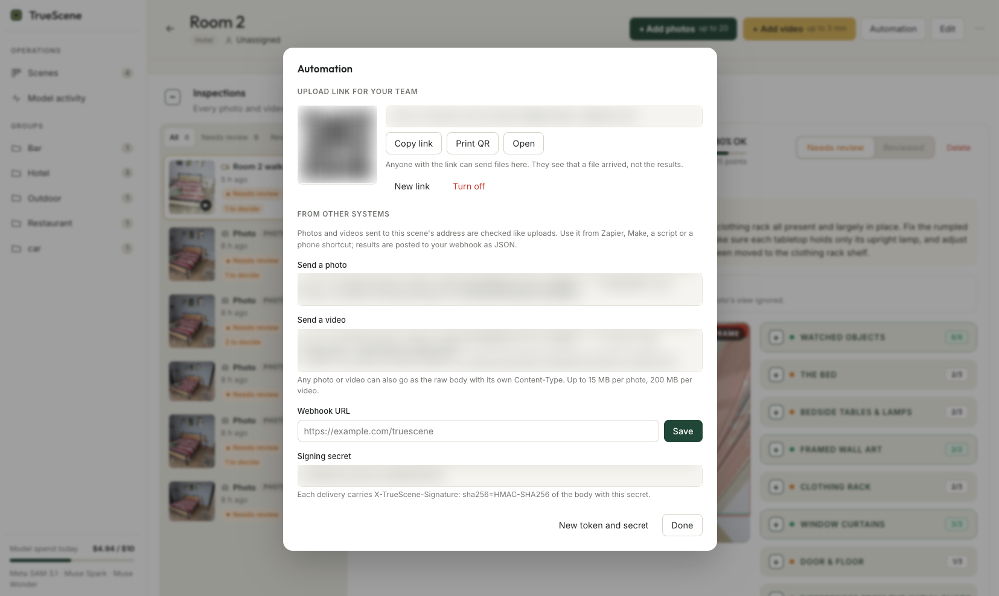
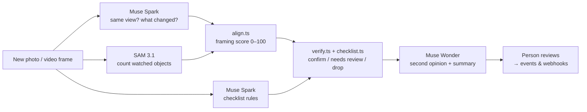

<div align="center">

# TrueScene

**Photograph a place once when it's right. Know when it isn't.**

TrueScene compares every new photo or video of a hotel room, restaurant table or bar shelf against one *initial photo*,
turns the differences into findings, and asks a person to review them.

[**▶ Try the live demo**](https://truescene.fly.dev) · [How it works](#how-it-works) · [Run it yourself](#run-it-yourself) · [API & webhooks](#automation-upload-links-api-webhooks)

    

*Built for the Meta Global AI Developer Hackathon 2026.*

</div>

---

## Try it in 10 seconds

1. Open **https://truescene.fly.dev**
2. Click **Try TrueScene**. No sign-up: you get your own private copy of six real scenes (hotel rooms, a restaurant table, a bar shelf, an outdoor entrance), with photo and video inspections already run and waiting for review
3. Open a card in **Needs review**, confirm or dismiss each finding, and mark the inspection reviewed

Each demo workspace has its own small model budget, so you can also upload your own photos.
If the first page load is slow, the server is waking up. Give it a few seconds.

## The problem

Hotels, restaurants and shops check the same places every day. Is the bed made? Are all 18 bottles on the shelf? Is the entrance clean?
Someone has to walk there and look, and "looks fine" means something different to every person.

TrueScene makes the standard a photo. Take it once when the place is perfect. After that, a housekeeper's phone photo, a walk-through video or a fixed camera is checked against it.
Models do the looking, and **a person makes every final call**.

## Screenshots

| Board | Scene | Inspection |
|---|---|---|
|  |  |  |
| Every scene, sorted by what a person has to do next | The initial photo, watched objects and the checklist | The initial and new photos side by side, with findings to confirm or dismiss |

| Video inspection | Upload link & automation |
|---|---|
|  |  |
| One walk-through video becomes an inspection for every scene it shows | Print a QR code for staff, or send photos from any camera or workflow tool |

## How it works

1. **Set the standard.** Upload the initial photo. Muse Spark lists the objects, and SAM 3.1 outlines and counts each one. Remove what you don't care about, or tap the photo to add something. Muse Wonder drafts a checklist in sections ("The bed: duvet is smooth…"), and you can edit every rule.
2. **Inspect.** Send a new photo, or a video that covers one scene or a whole group. Three checks run in parallel: is it the same view, what changed, and how many of each watched object are there.
3. **Decide with rules.** Code, not the model, turns model output into findings, and each finding records why it was made. SAM's count is the truth for objects. Anything Spark only *thinks* it saw gets a second opinion from Muse Wonder, then goes to a person.
4. **Review.** Confirm or dismiss each finding and add a note. "Reviewed" unlocks only once every finding is decided. The history shows who decided what, and when.



### Which Meta model does what

| Model | Used for |
|---|---|
| **SAM 3.1** | Outlining and counting every watched object, in the initial photo and in every inspection |
| **Muse Spark** (`muse-spark-1.3`) | Listing objects, checking it's the same view, finding differences, checking checklist rules, picking video frames |
| **Muse Wonder** (`muse-wonder-1.0`) | Drafting checklists, a second opinion before a finding reaches a person, inspection summaries |

All runtime models are Meta models.

## Features

**Board and scenes**
- Kanban board: `Not set up → Ready → Needs review → Issues → Reviewed`, with live counts
- Group scenes by location, floor or client, and assign each scene to a person (with autocomplete); filter from the sidebar
- Initial photo with auto-detect, tap-to-add, editable boxes and hover highlight; checklist in collapsible sections

**Checks you can trust**
- Framing score (`aligned / slightly_off / far_off`) with retake hints such as *"Turn a little right"*. Items that are new only at the photo's edge are marked *outside the initial frame* instead of flagged
- A model never closes an issue by itself. Findings it isn't sure about go to a person
- Re-check any inspection after you change the initial photo, items or checklist

**Video inspections**
- A video is sampled at 1 frame per second. Each time it shows a scene, the best frame becomes an inspection for that scene (up to 5 per scene)
- Start one from a scene, or from a group to cover every scene in it. Scenes the video never showed get a *Not seen* notice
- **▶ Watch video** plays the recording from the frame that was checked

**Operations**
- Live progress over SSE, and a **Model activity** page with the time and cost of every model call
- Daily spending cap, plus a separate budget for each demo workspace
- A single Node server with SQLite; EXIF and GPS data are removed from uploads

## Automation: upload links, API, webhooks

**Upload link for staff.** Scene → **Automation** → **Create upload link** gives you a link and a printable QR code. Staff open it on their phone (no account), enter their name once, and take or choose photos and videos. **New link** or **Turn off** disables the old link and every printed QR code at once.

**Ingest API.** Each scene has its own endpoint and token, so anything that can send an HTTP request can feed it: n8n, Zapier, Make, iOS Shortcuts or a camera job.

```bash
# photo (multipart, or a raw body with Content-Type: image/jpeg)
curl -H "Authorization: Bearer $TOKEN" -F image=@photo.jpg \
  https://your-app.example/api/ingest/$SCENE_ID
# 202 {"checkId":"chk_…","snapshotId":"snp_…"}

# video (raw body)
curl -H "Authorization: Bearer $TOKEN" -H "Content-Type: video/mp4" --data-binary @video.mp4 \
  "https://your-app.example/api/ingest/$SCENE_ID?name=Morning%20round"
# 202 {"videoId":"ins_…","statusPath":"/api/ingest/$SCENE_ID/videos/ins_…"}
```

**Signed webhooks.** The `X-TrueScene-Signature` header is the HMAC-SHA256 of the request body, keyed with the webhook secret.
- `check.finished`: sent for every photo, and for every time a video shows the scene
- `video.finished`: sent once per video, including when the video never showed the scene (`scene.status` is `not_seen` or `failed`)

<details>
<summary>Payloads and polling</summary>

```json
{ "event": "check.finished", "check": { "id": "chk_…", "sceneId": "scn_…", "status": "issues", "score": { "ok": 4, "total": 5 } } }
{ "event": "video.finished", "video": { "id": "ins_…", "name": "Morning round", "status": "done", "scene": { "sceneId": "scn_…", "status": "found", "checkIds": ["chk_…"] } } }
```

```bash
curl -H "Authorization: Bearer $TOKEN" https://your-app.example/api/ingest/$SCENE_ID/checks/$CHECK_ID
curl -H "Authorization: Bearer $TOKEN" https://your-app.example/api/ingest/$SCENE_ID/videos/$VIDEO_ID
```

</details>

## Run it yourself

You need Node 22.5+, `ffmpeg` on your PATH (`brew install ffmpeg`), and a Meta model API key.

```bash
git clone https://github.com/nodarik/TrueScene.git
cd TrueScene
npm install
echo "MODEL_API_KEY=your-meta-api-key" > .env   # other settings: see Configuration below
npm run dev
```

Open http://localhost:5173 (the API runs on :8791 behind a proxy). To build the demo scenes from your own photos, run `npx tsx scripts/seed-demo.ts`. It reads `Media/<scene>/`, where `main_photo.jpg` becomes the initial photo and every other photo or video becomes an inspection.

**Deploy:** `fly deploy` uses the included `Dockerfile` (with ffmpeg) and `fly.toml` (a volume at `/data`). Set `MODEL_API_KEY` and `ACCESS_CODE` with `fly secrets set`.

<details>
<summary>Configuration</summary>

| Variable | Default | What |
|---|---|---|
| `MODEL_API_KEY` | required | Meta model API key |
| `SPARK_MODEL` / `WONDER_MODEL` / `SAM_MODEL` | `muse-spark-1.3` / `muse-wonder-1.0` / `sam-3.1` | Model versions |
| `ACCESS_CODE` | empty | Admin login. If empty, there is no login (local use only) |
| `DATA_DIR` | `./data` | SQLite database, photos, videos and frames |
| `DAILY_SPEND_LIMIT_USD` | `10` | Hard stop for all model calls each day |
| `GUEST_SPEND_LIMIT_USD` | `1` | Budget of each demo workspace |
| `API_PORT` / `FFMPEG_PATH` | `8791` / `ffmpeg` | Port / ffmpeg binary |

| Command | What |
|---|---|
| `npm run dev` | API (watch mode) + web (hot reload) |
| `npm run build` / `npm start` | Build the web app to `dist/web` / serve it from the API |
| `npm run typecheck` | `tsc --noEmit` |

</details>

<details>
<summary>Project layout</summary>

```
server/  index.ts (routes)  meta.ts (model calls)  golden.ts (initial photo setup)
         verify.ts  align.ts  checklist.ts (model output → decisions)
         video/ (frames, frame picking, video inspections)  webhook.ts  workspaces.ts  runlog.ts
web/     board.tsx  scene.tsx  inspection.tsx  photo.tsx  upload.tsx  api.ts  styles.css
scripts/ seed-demo.ts  spike.ts
```

</details>

## Privacy

All data stays in `DATA_DIR` on your own server. Uploads are re-encoded, which removes GPS and other EXIF data. Demo workspaces are deleted after a week without use.

## License

[MIT](LICENSE)
